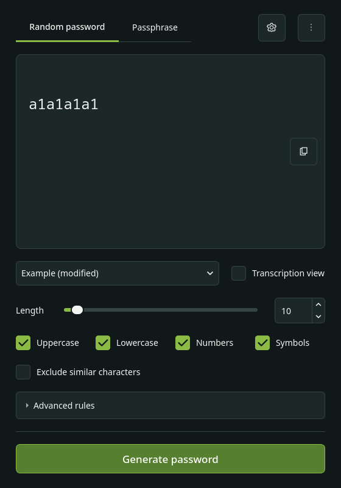
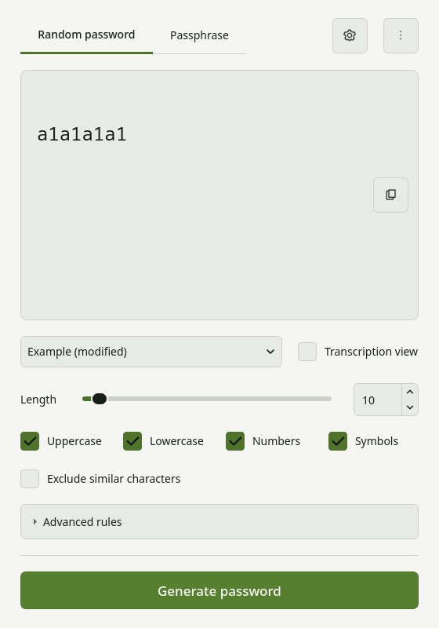
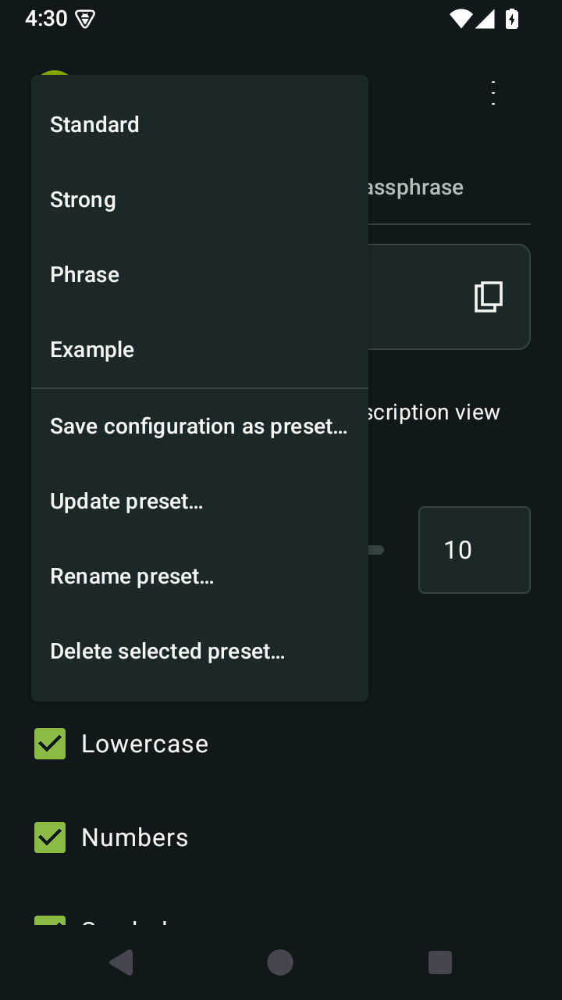
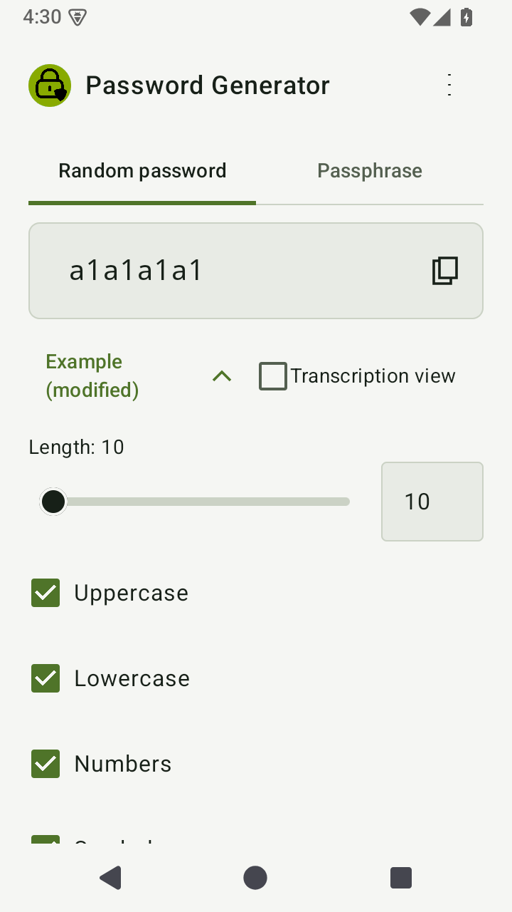

# Password Generator

Password Generator creates random passwords and readable passphrases locally
on Windows, Linux and Android. The desktop app uses PySide6; Android uses
Kotlin and Jetpack Compose. Both support a built-in Polish word list and
custom word lists.

Prebuilt standalone packages run without Python or an activated virtual
environment.

## Features

* Random passwords and readable passphrases
* Cryptographic randomness: Python `secrets` and Android `SecureRandom`
* Configurable length, character groups, word count and separators
* Built-in Polish word list and custom UTF-8 word lists
* Built-in presets and named custom presets, with updating and renaming
* Optional exclusion of similar characters (`0 O o 1 I l`)
* Larger monospace transcription view with natural character spacing
* Complete-result copying, wrapping and scrolling for long results
* Light/dark themes and Polish/English interfaces

Generated passwords remain in memory; they are not saved in settings or presets.
Automatic copying is off by default. Switching modes clears the result without
generating another password. An unavailable custom word list produces an error
instead of silently selecting another dictionary.

## v1.4.0 — preset editing

Custom presets can now be renamed or updated from the main generator view.
After changing settings, the preset shows **modified**. Choose **Update preset…**
and confirm its name to replace the saved configuration, or **Save preset…**
to create another preset. **Rename preset…** changes only its name. Built-in
presets remain protected. Existing presets remain compatible.

[Preset editing and verification](docs/v1.4.0/README.md).

## v1.3.0 — Advanced generation

The optional **Advanced rules** section adds minimum counts for each character
group, a custom alphabet, forbidden characters, first/last character types and
a limit on identical consecutive characters. A minimum of zero makes a group
optional in advanced mode. Expand the section and enable
**Use advanced rules** to apply them. With advanced mode off, the classic
random-password generator retains its existing behavior.

Custom and forbidden alphabets use visible ASCII (`!` through `~`, without
spaces). Advanced generation samples uniformly from all valid results using
exact integer counts. Impossible rules show an error; rules allowing a single
result show a warning. Passphrases are unaffected.

New rules can be saved in presets. Presets from v1.2.0 remain compatible.
Transcription view now enlarges the original text without the previous
four-character grouping; copying always preserves the exact original.

[Generation rules and algorithm](docs/v1.3.0/algorithm.md) ·
[Preset compatibility](docs/v1.3.0/presets.md)

## Android

The native Android project is located in [`android/`](android/). It supports
both generation modes, the built-in Polish word list, custom text word lists
and clipboard copying. Open that directory in Android Studio to build and run
the application. See [`android/README.md`](android/README.md) for requirements.

## Download

Download the latest published package for your platform; no GitHub login is
needed. Standalone desktop packages run without installing Python.

| Platform | Download |
| --- | --- |
| Android 8.0+ | [Android APK](https://github.com/Franek2009/Password-Generator/releases/latest/download/PasswordGenerator-android.apk) |
| Linux x86-64 | [Linux archive](https://github.com/Franek2009/Password-Generator/releases/latest/download/PasswordGenerator-linux-x86_64.tar.gz) |
| Windows x86-64 | [Windows archive](https://github.com/Franek2009/Password-Generator/releases/latest/download/PasswordGenerator-windows-x86_64.zip) |

[Release notes and all files](https://github.com/Franek2009/Password-Generator/releases/latest).
The published Android APK uses the existing distribution signing key.

[Third-party dependency sources](https://github.com/Franek2009/Password-Generator/releases/latest/download/PasswordGenerator-third-party-sources.tar.gz)
are provided for license compliance and are not required to run the app.

[Verification details and preset editing gallery](docs/v1.4.0/README.md).

## Screenshots

The running desktop and Android interfaces in both themes. Example passwords
are public demonstration strings. Android captures use an API-35 emulator.

| Platform | Dark theme | Light theme |
| --- | --- | --- |
| Desktop |  |  |
| Android |  |  |

[Full v1.4.0 gallery](docs/v1.4.0/README.md#previews) ·
[Archived v1.3.0 gallery](docs/v1.3.0/README.md#verified-previews) ·
[Archived v1.2.0 gallery](docs/v1.2.0-preview/README.md) ·
[Archived v1.1.0 gallery](docs/ui-preview/README.md)

## Running the Standalone Application

### Linux

Extract the downloaded archive and run the executable:

```bash
tar -xzf PasswordGenerator-linux-x86_64.tar.gz
cd PasswordGenerator
./PasswordGenerator
```

The Linux package is portable. It does not install the application
system-wide, add menu entries or modify system configuration. Keep the
executable together with its `_internal` directory.

### Windows

1. Extract `PasswordGenerator-windows-x86_64.zip` using **Extract All**.
2. Open the extracted `PasswordGenerator` directory.
3. Run `PasswordGenerator.exe`.

Keep `PasswordGenerator.exe` together with its `_internal` directory.

Windows may display a Microsoft Defender SmartScreen warning because the
application is not digitally signed. Review that the package came from this
project's GitHub Releases page before choosing to run it.

## Using the Application

### Random Password Mode

Random password mode generates highly random passwords. The following
character sets can be enabled independently:

* uppercase letters
* lowercase letters
* numbers
* special characters

The password length can be configured from **8 to 64 characters**. At least
one character set must be enabled.

With **Advanced rules off**, selecting multiple character sets guarantees at
least one character from every selected set, provided the requested length is
sufficient. Advanced mode follows the explicit minima instead.

### Passphrase Mode

Passphrase mode generates more readable passwords from randomly selected words.
The user can configure:

* number of words
* separator
* word list
* numbers
* special characters

Supported separators are `-`, `_`, `.`, space, `/`, `|` and `Random`. When
`Random` is selected, one separator is chosen and used consistently throughout
the generated password.

Words are selected without replacement when the list contains enough entries.
If more words are requested than are available, the remaining words are
selected with replacement. The first Unicode character of each word is uppercased before combining;
the remaining characters retain their original case (for example, `iPhone`
becomes `IPhone` on both desktop and Android).

Example output:

```text
Rower-42-Zamek-!-Las
```

The exact output is random and changes with every generation.

### Custom Word Lists

Passphrase mode accepts custom UTF-8 `.txt` word lists containing one word per
line:

```text
kot
pies
zamek
rower
las
```

The application validates custom lists and reports missing files, empty lists
and invalid text encoding.

### Clipboard

Select the **copy icon** to place the generated password in the system clipboard. The
application does not intentionally save the password to a file or database.

## Security

Password generation uses Python's `secrets` module instead of the standard
`random` module. `secrets` is designed for values that need to be
unpredictable, including passwords and security tokens.

Random password mode also ensures that every enabled character set is
represented when the configured length permits it.

Generated passwords are not intentionally persisted by the application.
Remember that copying a password places it in the operating system clipboard,
where other applications may be able to read it.

## Limitations

Password Generator:

* does not store generated passwords
* does not synchronize passwords between devices
* is not a password manager
* does not provide automatic updates
* does not include a system-wide installer

Use a dedicated password manager if you need encrypted storage,
synchronization, autofill or account management.

## Development

### Requirements

* Python 3.14+
* PySide6
* pytest and pytest-qt for testing
* PyInstaller for standalone builds

### Setup

Clone the repository:

```bash
git clone git@github.com:Franek2009/Password-Generator.git
cd Password-Generator
```

The default `master` branch contains the redesigned interface; no branch switch is needed.

Create a virtual environment:

```bash
python -m venv .venv
```

Activate it on Linux or macOS:

```bash
source .venv/bin/activate
```

Activate it on Windows:

```powershell
.venv\Scripts\activate
```

Install runtime dependencies:

```bash
python -m pip install -r requirements.txt
```

For development and testing, install:

```bash
python -m pip install -r requirements-dev.txt
```

Run the application from source:

```bash
python main.py
```

### Testing

Run the complete test suite:

```bash
python -m pytest
```

The test suite covers:

* Random password and Passphrase modes
* configuration and edge-case validation
* character sets and password lengths
* secure word selection
* built-in and custom word lists
* resource handling for source and bundled execution
* application metadata and icon configuration
* GUI controls and mode switching
* clipboard behaviour
* error handling

Before committing changes, run:

```bash
python -m pytest
git diff --check
git status
```

GitHub Actions runs the automated tests and prepares standalone packages for
Linux x86-64 and Windows x86-64.

### Local Standalone Build

Install the pinned build dependencies:

```bash
python -m pip install -r requirements-build.txt
```

Build from the versioned PyInstaller configuration:

```bash
python -m PyInstaller --noconfirm --clean PasswordGenerator.spec
```

The onedir bundle is written to `dist/PasswordGenerator/`.

## Architecture

The project separates application configuration, password generation,
resource and word-list handling and the graphical interface.

```text
User
  ↓
PySide6 GUI
  ↓
PasswordConfig and validation
  ↓
Password generator
  ├── Random password mode → character sets
  └── Passphrase mode → built-in or custom word list
  ↓
Generated password
  ↓
GUI / Clipboard
```

### Project Structure

```text
Password-Generator/
├── .github/workflows/
│   ├── package.yml
│   ├── release.yml
│   └── tests.yml
├── app/
│   ├── errors.py
│   ├── presets.py
│   ├── result_view.py
│   ├── presentation.py
│   ├── application.py
│   ├── config.py
│   ├── generator.py
│   ├── resources.py
│   ├── ui.py
│   └── wordlist.py
├── assets/
│   ├── icon.png
│   ├── icon.svg
│   └── README.md
├── data/
│   ├── ui.json
│   ├── words.txt
│   └── README.md
├── tests/
│   ├── test_application.py
│   ├── test_generator.py
│   ├── test_resources.py
│   ├── test_ui.py
│   └── test_wordlist.py
├── main.py
├── PasswordGenerator.spec
├── requirements.txt
├── requirements-build.txt
├── requirements-dev.txt
├── LICENSE
└── README.md
```

`main.py` is the application entry point. `app/config.py` defines password
configuration and validation, while `app/generator.py` contains both generation
modes. `app/wordlist.py` loads built-in and custom lists. `app/resources.py`
resolves files when running from source or a PyInstaller bundle.
`app/application.py` configures application metadata and the runtime icon, and
`app/ui.py` contains the PySide6 interface.

## Built-in Word List

The built-in Polish word list is stored in `data/words.txt`. It is based on the
[diceware-pl](https://github.com/MaciekTalaska/diceware-pl) project by Maciek
Tałaska and is included under the MIT License.

See [`data/README.md`](data/README.md) for source and attribution details.

## License

The Password Generator source code is licensed under the MIT License. See
[`LICENSE`](LICENSE) for the full license text.

## Credits

### Polish word list

The built-in Polish word list is based on
[diceware-pl](https://github.com/MaciekTalaska/diceware-pl)
by Maciek Tałaska.

### Application icon

The application icon was designed for Password Generator.

The lock symbol used in the icon is
[Lock Alt by Amanda Moita](https://inkscape.org/~amandamoita/%E2%98%85lock-alt-svgrepo-com)
and is licensed under
[CC0 1.0](https://creativecommons.org/publicdomain/zero/1.0/).

If you use this project, attribution is appreciated.

## Release sources and maintenance

Releases include `PasswordGenerator-android.apk` for Android 8.0 and newer.
See [Android signing and installation](android/README.md) for setup.
Dependency sources and their checksum manifest are distributed together in
`PasswordGenerator-third-party-sources.tar.gz`; users do not need that archive
to run the application.

To preview consolidation of the original v1.0.2 source attachments, run
`python scripts/compact_release.py`. Add `--apply` to download and verify all
original sources, upload and download-check the combined archive, update the
release description and only then delete the replaced source attachments.
Desktop binaries and the release tag are preserved. This requires authenticated
GitHub CLI access and several GiB of temporary disk space.

## Interface settings

The redesigned desktop and Android interfaces use **Random password** and
**Passphrase** tabs, a result field with a copy action and a green Generate
button. All passphrase controls remain on the main screen.

Settings support system/light/dark appearance, system/Polish/English language
and optional automatic copying (off by default). Preferences and each mode's
configuration survive application restarts. Generated passwords do not.
Android retains the current result when the device rotates. There is no history.

Custom word lists remain selectable as UTF-8 text files. An unavailable saved
list causes an error and requires an explicit list selection; the application does not silently choose another dictionary.
Android's clipboard marks copied passwords as sensitive on Android 13+.

See the [advanced-generation gallery and validation notes](docs/v1.3.0/README.md).
