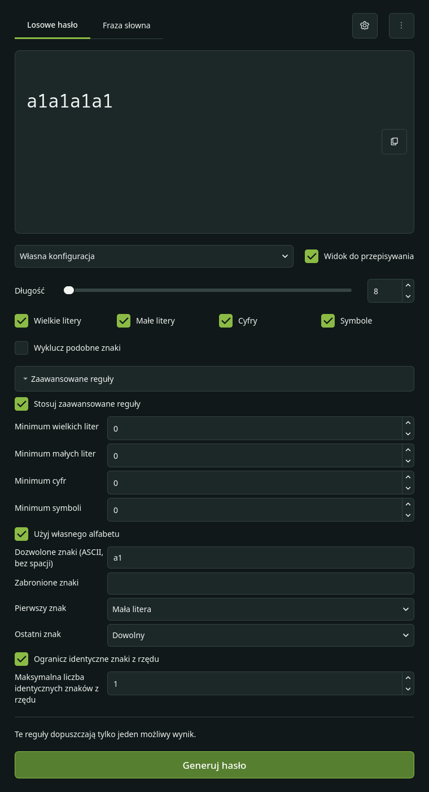
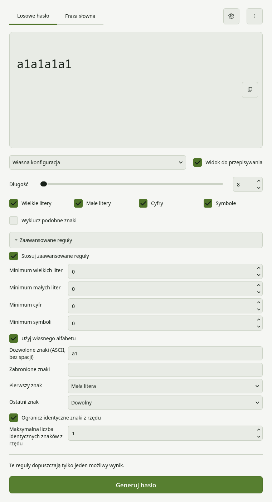
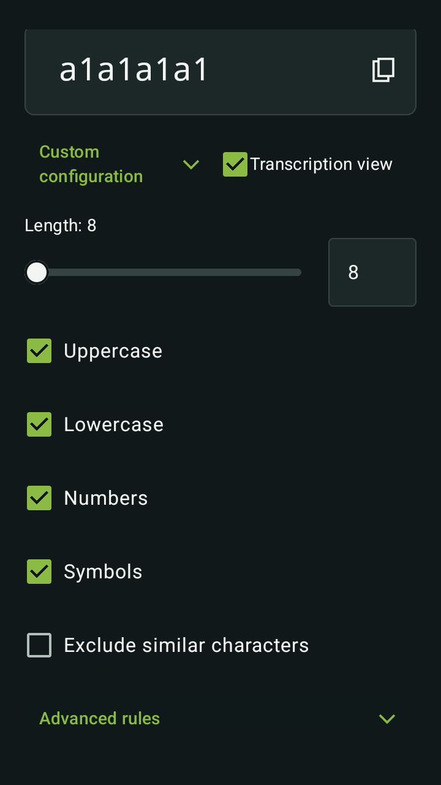
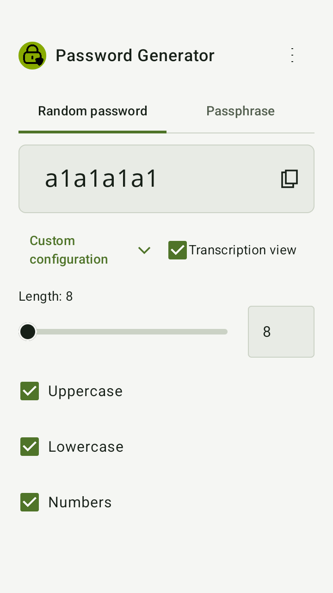
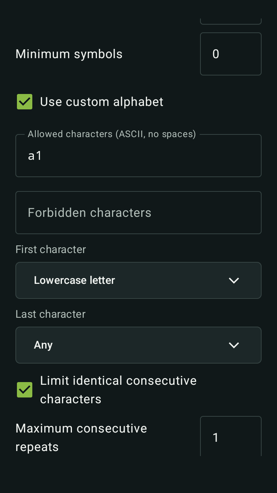
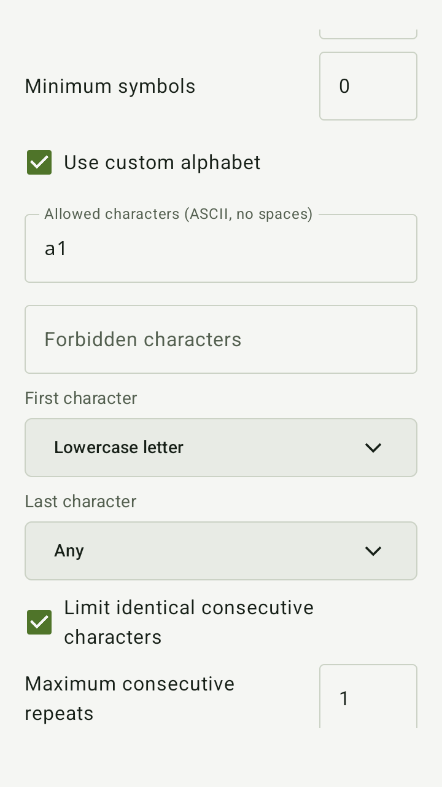

# Password Generator

Password Generator creates random passwords and readable passphrases locally
on Windows, Linux and Android. The desktop app uses PySide6; Android uses
Kotlin and Jetpack Compose. Both support a built-in Polish word list and
custom word lists.

Prebuilt standalone packages run without Python or an activated virtual
environment.

## Features

* Random password mode for highly random passwords
* Passphrase mode for readable word-based passwords
* Cryptographically secure randomness using Python's `secrets` module
* Configurable length, character sets, word count and separators
* Built-in Polish word list
* Custom `.txt` word lists
* Optional numbers and special characters
* Copying generated passwords to the clipboard
* Input validation and clear error messages
* Standalone Linux and Windows builds
* Native Android application in Kotlin and Jetpack Compose

## In development: advanced generation

The v1.3.0 test builds include an optional **Advanced rules** section on desktop
and Android. [Download a test build](#test-builds) to try these features.
These are development snapshots, not a published v1.3.0 release.

* Set minimum counts of uppercase/lowercase letters, digits and symbols.
  Zero makes a group optional in advanced mode.
* Restrict the alphabet and exclude literal characters. Custom/forbidden
  entries accept visible ASCII characters `!` through `~`, without spaces.
  Repeated entries have no extra weight; case matters. The custom alphabet
  intersects the enabled character groups, then forbidden/similar characters
  are removed.
* Restrict the first and last character by type and optionally limit identical
  consecutive characters. Endpoints count toward the minima. A repetition limit
  reduces the allowed results; it does not automatically increase security.
* Advanced generation samples uniformly from all results satisfying the rules,
  using exact integer counts and cryptographically secure randomness. Impossible
  combinations show an error; rules allowing only one result show a warning.
* Rules can be saved in presets. Existing presets are read lazily; the first
  preset edit writes version 2 separately and preserves the original data.
  Applying a preset validates feasibility without generating a password.

Expanding the section does not enable advanced mode. With advanced mode off,
random generation retains its previous behavior and character-group guarantee.
Advanced rules do not affect passphrases. Computation runs outside the UI thread;
changing the configuration cancels/discards pending results. Generated passwords
are never written to settings or presets.

[Algorithm and uniformity argument](docs/v1.3.0/algorithm.md),
[migration details](docs/v1.3.0/presets.md), and
[verification and new previews](docs/v1.3.0/README.md) describe the changes.

## Existing features from v1.2.0

The advanced-generation update retains these desktop and Android features:

* **Presets:** Standard (16 characters), Strong (24 characters), and Phrase
  (5 words, `-`, built-in Polish list, no added numbers or symbols). Select a
  preset below the result. Save or delete named custom presets through the
  desktop overflow menu or Android preset menu. Built-ins cannot be deleted.
* Presets restore only the active mode's generator parameters. Names must be
  unique (including built-in names), with 1–64 characters. Theme, language,
  automatic copying and transcription view remain independent preferences.
* **Exclude similar characters:** optionally removes `0 O o 1 I l` in random
  mode while preserving every selected character set. Off by default; saved
  with preferences and random-mode presets. Passphrases are unaffected.
* **Transcription view:** larger monospace text with the original character
  spacing. The v1.3.0 preview removes the previous four-character grouping to
  make passwords easier to read. Passphrases retain their words and separators.
  Copying retains the entire original result. Switching this view does not
  generate or copy a new password.
* Long results wrap and scroll. Switching generator modes or applying a preset
  clears the result without generating another password.

Presets contain configuration only. Results are never saved in settings or
presets. Invalid preset records are ignored with a warning. An unavailable
custom word list, including a lost Android document permission, causes an
error; generation and preset application do not silently substitute a dictionary.
Choose the built-in list or select the custom file again to recover.

[Screenshots](docs/v1.2.0-preview/README.md) and the
[release audit](docs/v1.2.0-audit.md) document the implementation and verification.

## Android

The native Android project is located in [`android/`](android/). It supports
both generation modes, the built-in Polish word list, custom text word lists
and clipboard copying. Open that directory in Android Studio to build and run
the application. See [`android/README.md`](android/README.md) for requirements.

## Test builds

**For testing the new advanced rules, download one of these builds.** All three
packages contain application code from commit
[`ea055d7`](https://github.com/Franek2009/Password-Generator/commit/ea055d70cc084bd6871391af5259c4da47a70624)
on `feature/v1.3.0-advanced-generation`. Later documentation-only commits do not
change these binaries.

| Platform | Test download | Artifact name |
| --- | --- | --- |
| Android 8.0+ | [Download debug APK artifact](https://github.com/Franek2009/Password-Generator/actions/runs/42085993094/artifacts/13442448155) | `PasswordGenerator-android-debug` |
| Linux x86-64 | [Download Linux artifact](https://github.com/Franek2009/Password-Generator/actions/runs/42085991013/artifacts/13443521678) | `PasswordGenerator-linux-x86_64.tar.gz` |
| Windows x86-64 | [Download Windows artifact](https://github.com/Franek2009/Password-Generator/actions/runs/42085991013/artifacts/13442712119) | `PasswordGenerator-windows-x86_64.zip` |

1. Sign in to GitHub to download Actions artifacts. If a direct download does
   not start, open the [desktop build](https://github.com/Franek2009/Password-Generator/actions/runs/42085991013)
   or [APK build](https://github.com/Franek2009/Password-Generator/actions/runs/42085993094)
   and select the artifact listed above in **Artifacts** at the bottom.
2. Extract the outer artifact ZIP. On desktop, also extract the enclosed
   platform archive and run the application from its complete extracted folder.
   On Android, the artifact contains `app-debug.apk`.
3. Open **Random password → Advanced rules**, expand the section and enable
   **Use advanced rules**. Expanding the section alone leaves the rules disabled.

The APK uses a debug signing key and cannot update the stable release signed
with the distribution key. Development builds may display a development version
rather than `1.3.0`; the source commit above identifies this test snapshot.
Artifacts have limited retention; if expired, rerun the existing build workflows
for the desired branch instead of downloading the stable release by mistake.

The [Windows/Linux package build](https://github.com/Franek2009/Password-Generator/actions/runs/42085991013),
[APK build](https://github.com/Franek2009/Password-Generator/actions/runs/42085993094),
[Python tests](https://github.com/Franek2009/Password-Generator/actions/runs/42085993371)
and [Android UI tests on API 26 and 35](https://github.com/Franek2009/Password-Generator/actions/runs/42085993657)
all passed for this application revision. Building Windows successfully does not
replace manual testing on Windows or a physical Android phone.

### Latest stable release

The links below download published releases. For testing advanced generation,
use the CI artifacts above. Stable-release downloads need no GitHub login.

| Platform | Download |
| --- | --- |
| Android 8.0+ | [Android APK](https://github.com/Franek2009/Password-Generator/releases/latest/download/PasswordGenerator-android.apk) |
| Linux x86-64 | [Linux archive](https://github.com/Franek2009/Password-Generator/releases/latest/download/PasswordGenerator-linux-x86_64.tar.gz) |
| Windows x86-64 | [Windows archive](https://github.com/Franek2009/Password-Generator/releases/latest/download/PasswordGenerator-windows-x86_64.zip) |

[Latest release notes and all files](https://github.com/Franek2009/Password-Generator/releases/latest). Android installs as an
update using the existing signing key. Compare the version in Android app info
with the version shown on the release page.

[Third-party dependency sources](https://github.com/Franek2009/Password-Generator/releases/latest/download/PasswordGenerator-third-party-sources.tar.gz)
are provided for license compliance; they are not required to run the app.

## Screenshots — advanced rules preview

These captures show the running v1.3.0 development interface in light and dark
mode. Desktop captures use the native Qt UI; Android captures come from an
API-35 emulator. The deliberately forced public example `a1a1a1a1` illustrates
the single-result warning and must not be used as a password.

| View | Dark theme | Light theme |
| --- | --- | --- |
| Desktop advanced rules |  |  |
| Android result |  |  |
| Android character and repetition rules |  |  |

[Full preview gallery and verification notes](docs/v1.3.0/README.md).
Earlier references remain available in the
[v1.2.0 gallery](docs/v1.2.0-preview/README.md) and the
[v1.1.0 gallery](docs/ui-preview/README.md).

## Running the Standalone Application

### Linux

Extract the downloaded archive and run the executable:

```bash
tar -xzf PasswordGenerator-linux-x86_64.tar.gz
cd PasswordGenerator
./PasswordGenerator
```

The Linux package is portable. It does not install the application
system-wide, add menu entries or modify system configuration. Keep the
executable together with its `_internal` directory.

### Windows

1. Extract `PasswordGenerator-windows-x86_64.zip` using **Extract All**.
2. Open the extracted `PasswordGenerator` directory.
3. Run `PasswordGenerator.exe`.

Keep `PasswordGenerator.exe` together with its `_internal` directory.

Windows may display a Microsoft Defender SmartScreen warning because the
application is not digitally signed. Review that the package came from this
project's GitHub Releases page before choosing to run it.

## Using the Application

### Random Password Mode

Random password mode generates highly random passwords. The following
character sets can be enabled independently:

* uppercase letters
* lowercase letters
* numbers
* special characters

The password length can be configured from **8 to 64 characters**. At least
one character set must be enabled.

When multiple character sets are selected, the generator guarantees that at
least one character from every selected set is present, provided the requested
length is sufficient.

### Passphrase Mode

Passphrase mode generates more readable passwords from randomly selected words.
The user can configure:

* number of words
* separator
* word list
* numbers
* special characters

Supported separators are `-`, `_`, `.`, space, `/`, `|` and `Random`. When
`Random` is selected, one separator is chosen and used consistently throughout
the generated password.

Words are selected without replacement when the list contains enough entries.
If more words are requested than are available, the remaining words are
selected with replacement. The first Unicode character of each word is uppercased before combining;
the remaining characters retain their original case (for example, `iPhone`
becomes `IPhone` on both desktop and Android).

Example output:

```text
Rower-42-Zamek-!-Las
```

The exact output is random and changes with every generation.

### Custom Word Lists

Passphrase mode accepts custom UTF-8 `.txt` word lists containing one word per
line:

```text
kot
pies
zamek
rower
las
```

The application validates custom lists and reports missing files, empty lists
and invalid text encoding.

### Clipboard

Select the **copy icon** to place the generated password in the system clipboard. The
application does not intentionally save the password to a file or database.

## Security

Password generation uses Python's `secrets` module instead of the standard
`random` module. `secrets` is designed for values that need to be
unpredictable, including passwords and security tokens.

Random password mode also ensures that every enabled character set is
represented when the configured length permits it.

Generated passwords are not intentionally persisted by the application.
Remember that copying a password places it in the operating system clipboard,
where other applications may be able to read it.

## Limitations

Password Generator:

* does not store generated passwords
* does not synchronize passwords between devices
* is not a password manager
* does not provide automatic updates
* does not include a system-wide installer

Use a dedicated password manager if you need encrypted storage,
synchronization, autofill or account management.

## Development

### Requirements

* Python 3.14+
* PySide6
* pytest and pytest-qt for testing
* PyInstaller for standalone builds

### Setup

Clone the repository:

```bash
git clone git@github.com:Franek2009/Password-Generator.git
cd Password-Generator
```

The default `master` branch contains the redesigned interface; no branch switch is needed.

Create a virtual environment:

```bash
python -m venv .venv
```

Activate it on Linux or macOS:

```bash
source .venv/bin/activate
```

Activate it on Windows:

```powershell
.venv\Scripts\activate
```

Install runtime dependencies:

```bash
python -m pip install -r requirements.txt
```

For development and testing, install:

```bash
python -m pip install -r requirements-dev.txt
```

Run the application from source:

```bash
python main.py
```

### Testing

Run the complete test suite:

```bash
python -m pytest
```

The test suite covers:

* Random password and Passphrase modes
* configuration and edge-case validation
* character sets and password lengths
* secure word selection
* built-in and custom word lists
* resource handling for source and bundled execution
* application metadata and icon configuration
* GUI controls and mode switching
* clipboard behaviour
* error handling

Before committing changes, run:

```bash
python -m pytest
git diff --check
git status
```

GitHub Actions runs the automated tests and prepares standalone packages for
Linux x86-64 and Windows x86-64.

### Local Standalone Build

Install the pinned build dependencies:

```bash
python -m pip install -r requirements-build.txt
```

Build from the versioned PyInstaller configuration:

```bash
python -m PyInstaller --noconfirm --clean PasswordGenerator.spec
```

The onedir bundle is written to `dist/PasswordGenerator/`.

## Architecture

The project separates application configuration, password generation,
resource and word-list handling and the graphical interface.

```text
User
  ↓
PySide6 GUI
  ↓
PasswordConfig and validation
  ↓
Password generator
  ├── Random password mode → character sets
  └── Passphrase mode → built-in or custom word list
  ↓
Generated password
  ↓
GUI / Clipboard
```

### Project Structure

```text
Password-Generator/
├── .github/workflows/
│   ├── package.yml
│   ├── release.yml
│   └── tests.yml
├── app/
│   ├── errors.py
│   ├── presets.py
│   ├── result_view.py
│   ├── presentation.py
│   ├── application.py
│   ├── config.py
│   ├── generator.py
│   ├── resources.py
│   ├── ui.py
│   └── wordlist.py
├── assets/
│   ├── icon.png
│   ├── icon.svg
│   └── README.md
├── data/
│   ├── ui.json
│   ├── words.txt
│   └── README.md
├── tests/
│   ├── test_application.py
│   ├── test_generator.py
│   ├── test_resources.py
│   ├── test_ui.py
│   └── test_wordlist.py
├── main.py
├── PasswordGenerator.spec
├── requirements.txt
├── requirements-build.txt
├── requirements-dev.txt
├── LICENSE
└── README.md
```

`main.py` is the application entry point. `app/config.py` defines password
configuration and validation, while `app/generator.py` contains both generation
modes. `app/wordlist.py` loads built-in and custom lists. `app/resources.py`
resolves files when running from source or a PyInstaller bundle.
`app/application.py` configures application metadata and the runtime icon, and
`app/ui.py` contains the PySide6 interface.

## Built-in Word List

The built-in Polish word list is stored in `data/words.txt`. It is based on the
[diceware-pl](https://github.com/MaciekTalaska/diceware-pl) project by Maciek
Tałaska and is included under the MIT License.

See [`data/README.md`](data/README.md) for source and attribution details.

## License

The Password Generator source code is licensed under the MIT License. See
[`LICENSE`](LICENSE) for the full license text.

## Credits

### Polish word list

The built-in Polish word list is based on
[diceware-pl](https://github.com/MaciekTalaska/diceware-pl)
by Maciek Tałaska.

### Application icon

The application icon was designed for Password Generator.

The lock symbol used in the icon is
[Lock Alt by Amanda Moita](https://inkscape.org/~amandamoita/%E2%98%85lock-alt-svgrepo-com)
and is licensed under
[CC0 1.0](https://creativecommons.org/publicdomain/zero/1.0/).

If you use this project, attribution is appreciated.

## Release sources and maintenance

Releases include `PasswordGenerator-android.apk` for Android 8.0 and newer.
See [Android signing and installation](android/README.md) for setup.
Dependency sources and their checksum manifest are distributed together in
`PasswordGenerator-third-party-sources.tar.gz`; users do not need that archive
to run the application.

To preview consolidation of the original v1.0.2 source attachments, run
`python scripts/compact_release.py`. Add `--apply` to download and verify all
original sources, upload and download-check the combined archive, update the
release description and only then delete the replaced source attachments.
Desktop binaries and the release tag are preserved. This requires authenticated
GitHub CLI access and several GiB of temporary disk space.

## Interface settings

The redesigned desktop and Android interfaces use **Random password** and
**Passphrase** tabs, a result field with a copy action and a green Generate
button. All passphrase controls remain on the main screen.

Settings support system/light/dark appearance, system/Polish/English language
and optional automatic copying (off by default). Preferences and each mode's
configuration survive application restarts. Generated passwords do not.
Android retains the current result when the device rotates. There is no history.

Custom word lists remain selectable as UTF-8 text files. An unavailable saved
list causes an error and requires an explicit list selection; the application does not silently choose another dictionary.
Android's clipboard marks copied passwords as sensitive on Android 13+.

See the [advanced-generation gallery and validation notes](docs/v1.3.0/README.md).
