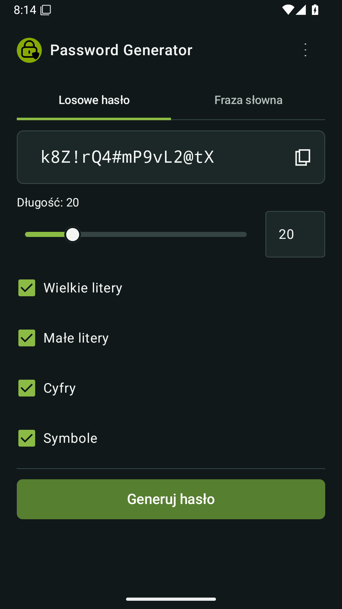
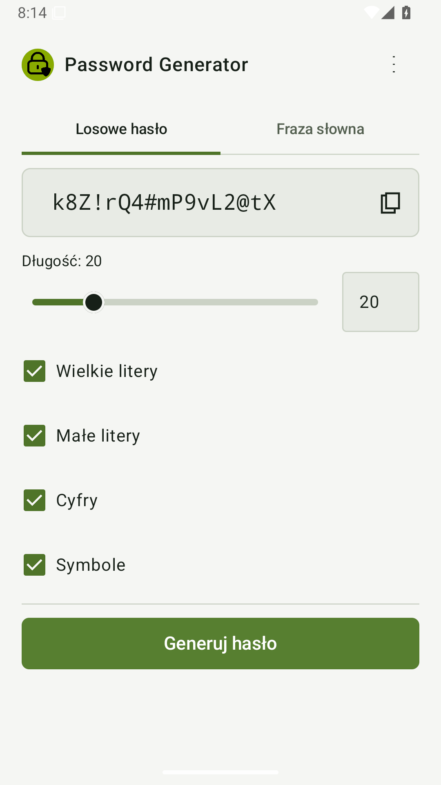

# Password Generator for Android

Natywna wersja aplikacji w Kotlinie i Jetpack Compose. Wymaga Android Studio,
JDK 17 oraz Android SDK 35. Minimalna obsługiwana wersja systemu to Android 8.0
(API 26).

## Pobierz najnowszą wersję — nowy interfejs

[Pobierz najnowsze APK](https://github.com/Franek2009/Password-Generator/releases/latest/download/PasswordGenerator-android.apk)
bezpośrednio z [publicznego wydania](https://github.com/Franek2009/Password-Generator/releases/latest). Logowanie do GitHuba
nie jest wymagane. Zainstaluj plik APK jako aktualizację aplikacji.

Wersję sprawdzisz w informacjach o aplikacji; powinna odpowiadać numerowi
najnowszego wydania na GitHubie. APK korzysta z dotychczasowego klucza
podpisywania i aktualizuje poprzednie wydania.

## Zrzuty nowego interfejsu

| Ciemny motyw | Jasny motyw |
| --- | --- |
|  |  |

[Pełna galeria telefonu i desktopu, ustawień oraz fraz słownych](../docs/ui-preview/README.md).

## Uruchomienie

1. Otwórz katalog `android` z głównej gałęzi `master` w Android Studio.
2. Poczekaj na synchronizację Gradle.
3. Wybierz emulator lub podłączone urządzenie.
4. Uruchom konfigurację `app`.

Testy logiki można uruchomić poleceniem `./gradlew test` (Linux/macOS) lub
`gradlew.bat test` (Windows).

Hasła są generowane lokalnie przy użyciu `SecureRandom`. Aplikacja nie wymaga
dostępu do internetu i nie zapisuje wygenerowanych haseł.

## Podpisane APK w GitHub Releases

Wydanie z tagu `vMAJOR.MINOR.PATCH` buduje testowane, podpisane APK
`PasswordGenerator-android.apk` i publikuje je obok paczek desktopowych.
`versionName` pochodzi z tagu, a `versionCode` to
`major * 1000000 + minor * 1000 + patch` (minor i patch < 1000).
Kolejne wydania muszą mieć rosnącą wersję. Wersje debug są dostępne w
Artifacts przebiegu Android APK i nie wymagają klucza wydawniczego.

Sekrety repozytorium wymagane do wydania:

- `ANDROID_KEYSTORE_BASE64`: zawartość magazynu PKCS12 zakodowana w base64;
- `ANDROID_KEYSTORE_PASSWORD`: hasło magazynu;
- `ANDROID_KEY_ALIAS`: alias klucza, domyślnie `password-generator`;
- `ANDROID_KEY_PASSWORD`: hasło klucza (dla PKCS12 takie samo jak magazynu).

Nowy klucz można wygenerować JDK `keytool`:

```bash
keytool -genkeypair -storetype PKCS12 -keystore password-generator.keystore \
  -alias password-generator -keyalg RSA -keysize 3072 -validity 10000
```

Zachowaj magazyn oraz hasło w bezpiecznej kopii zapasowej poza repozytorium.
Aktualizacje wymagają tego samego klucza. Nie dodawaj magazynu ani haseł do Git.
Lokalny build release wymaga zmiennych `PASSWORD_GENERATOR_RELEASE_TAG`,
`ANDROID_KEYSTORE_PATH`, `ANDROID_KEYSTORE_PASSWORD`, `ANDROID_KEY_ALIAS`
i `ANDROID_KEY_PASSWORD`, a następnie `./gradlew test lintRelease assembleRelease`.

Pobierz APK z Releases na telefon i zezwól przeglądarce lub menedżerowi plików
na instalowanie aplikacji z tego źródła. Wymagany jest Android 8.0 lub nowszy.
Przejście z wersji debug może wymagać odinstalowania starej aplikacji,
ponieważ jest podpisana innym kluczem.

## Interfejs i testy UI v1.1.0

Ekran generatora i ustawień używa wspólnych tekstów PL/EN i kolorów z desktopem.
Preferencje zapisuje SharedPreferences. Bieżące hasło jest wyłącznie w ViewModel,
więc przetrwa obrót ekranu, ale nie ponowne uruchomienie procesu aplikacji.
Własny słownik korzysta z trwałego uprawnienia do odczytu wybranego dokumentu.

Testy UI i eksport zrzutów (z katalogu głównego repozytorium, na gałęzi
`master`, przy jednym uruchomionym emulatorze):

```bash
bash scripts/android_ui_checks.sh
```

Skrypt zapisuje raporty Gradle i obrazy w `build/android-ui-preview/`.
Sam `connectedDebugAndroidTest` usuwa aplikację po testach wraz z jej plikami;
skrypt ponownie instaluje te same APK i eksportuje zrzuty przed usunięciem danych.

Zrzuty używają publicznych danych przykładowych. Galeria obu platform jest
w `docs/ui-preview/`; kod nowego UI został scalony do `master`.

Deweloperski podpisany podgląd kolejnej wersji bez publikowania wydania można
zbudować ręcznie w workflow
**Android APK**, wskazując gałąź `master` i planowany tag kolejnego wydania
w polu `release_tag`. APK używa
tego samego identyfikatora i klucza co wydania, więc aktualizuje aplikację.
Nie tworzy tagu Git ani wpisu w Releases.
