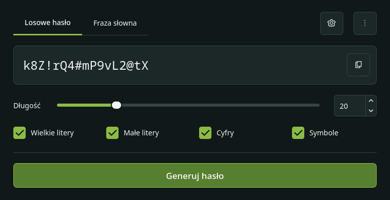
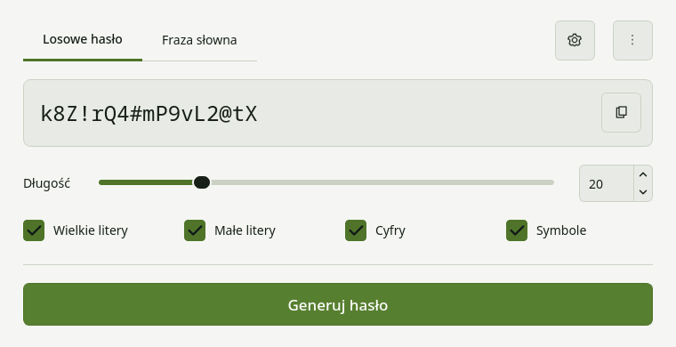
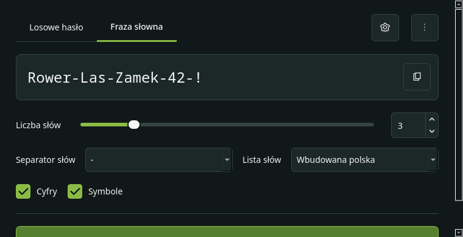
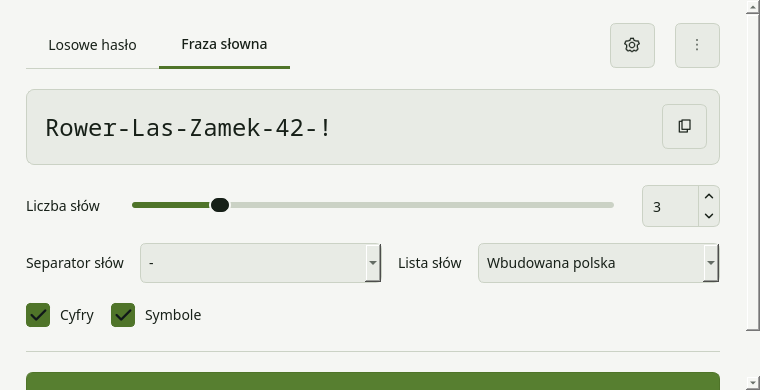
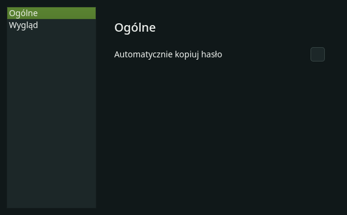
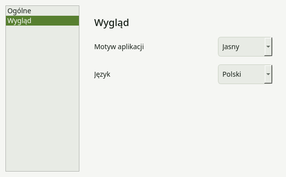
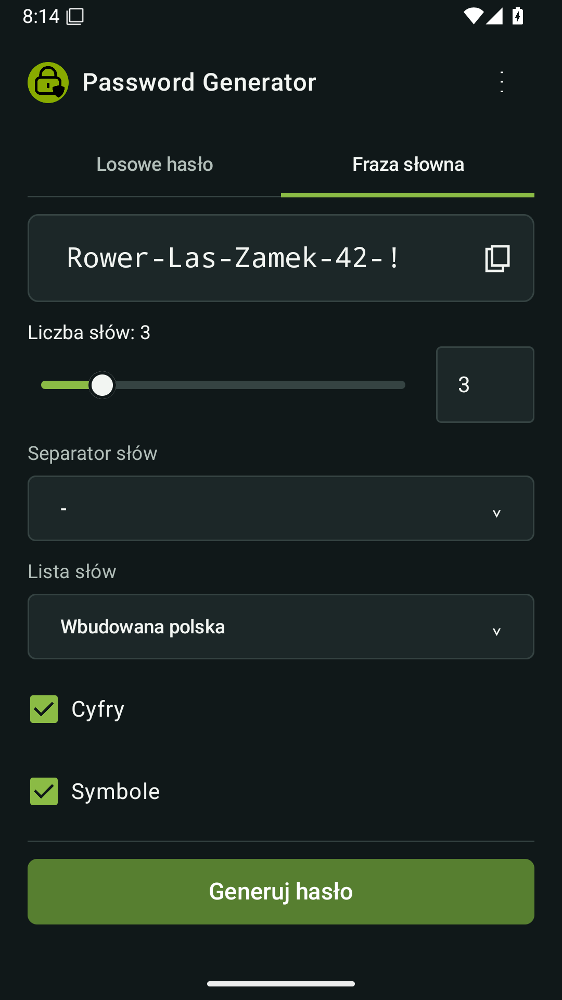
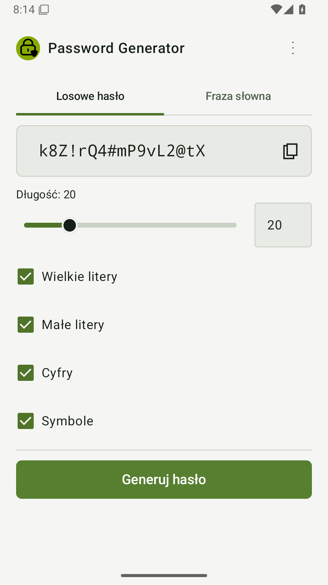
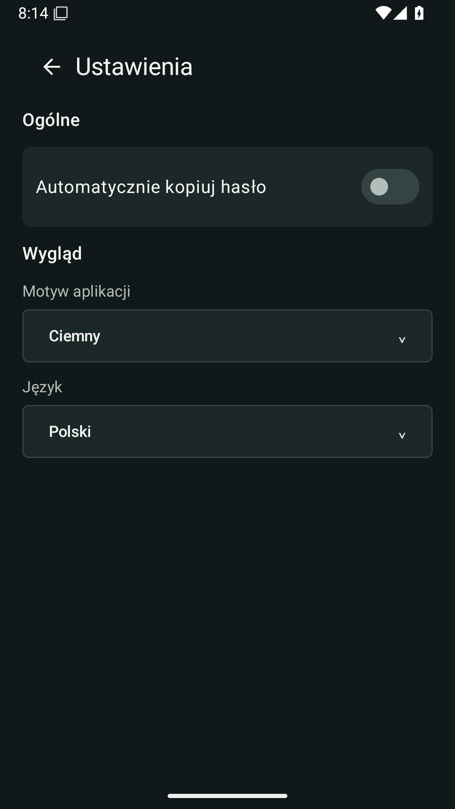
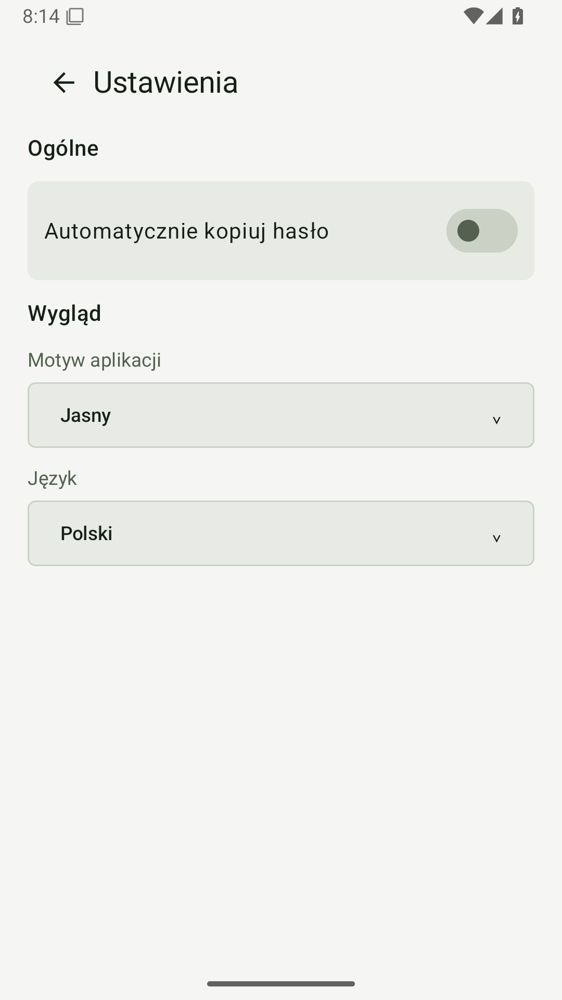

# Unified interface — v1.1.0

This preview follows the supplied desktop/Android reference. The existing
password-generation defaults (20 characters, 3 words, `-`) are retained.
The screenshots use public example strings, not user passwords.

| View | Dark | Light |
| --- | --- | --- |
| Desktop: random password |  |  |
| Desktop: passphrase |  |  |
| Desktop: settings |  |  |
| Android: random password |  |  |
| Android: passphrase |  |  |
| Android: settings |  |  |

[Desktop with English labels at minimum width](desktop-english-narrow.png).
[Android with English labels](android-english.png) and
[larger system font](android-english-large-font.png).
Android screenshots are captured from an Android 15 emulator by
`UnifiedUiTest.captureReviewScreenshots`.

Validation: 186 Python tests, 7 Android unit tests in each variant, Android
lint and debug build, and 3 instrumented tests on Android 15. Tests exercise
settings/language switching, copying, real orientation change, persistence
without storing the current result, and screenshot capture. The instrumented suite and screenshot export passed on Android API 26 and 35
in [the final UI verification run](https://github.com/Franek2009/Password-Generator/actions/runs/41237602489). Windows/Linux package builds
passed for the implementation branch.

Recreate desktop previews from `master`:

```bash
QT_QPA_PLATFORM=offscreen python scripts/preview_desktop.py
```

The native window title bar is supplied by the operating system and is not
included in Qt's offscreen captures.

The application now shares Polish/English strings, icon paths and color tokens
between PySide6 and Compose (`data/ui.json`, mirrored in Android assets).
The Python test suite checks that both copies remain identical.

Settings contain General (automatic clipboard copying) and Appearance
(system/light/dark theme and system/Polish/English language).
All passphrase controls remain on the generator screen. Each generation mode
retains its own numbers/symbols choices. Preferences are stored with QSettings
and SharedPreferences; passwords are never written to those stores. Android
keeps the current result in a ViewModel during configuration changes. There is
no password history.

The UI implementation is merged into `master`. The APK below is a signed
preview; the public v1.1.0 Release has not yet been published.

## Which download contains these screens?

The screenshots on this page show **the v1.1.0 UI preview**. Public stable
[v1.0.4](https://github.com/Franek2009/Password-Generator/releases/tag/v1.0.4)
still has the previous UI.

- [Android preview APK artifact](https://github.com/Franek2009/Password-Generator/actions/runs/41237143305/artifacts/13055587407)
- [Linux preview artifact](https://github.com/Franek2009/Password-Generator/actions/runs/41190912554/artifacts/13037984990)
- [Windows preview artifact](https://github.com/Franek2009/Password-Generator/actions/runs/41190912554/artifacts/13039125190)

All preview artifacts require GitHub login and have limited retention. Desktop
previews report a development version. The Android preview reports 1.1.0.

## Signed Android preview

[Download the signed APK artifact](https://github.com/Franek2009/Password-Generator/actions/runs/41237143305/artifacts/13055587407).
Sign in to GitHub, download the artifact, extract the ZIP and install the
enclosed `PasswordGenerator-android.apk`. GitHub login is required.
The local review copy
is `dist/PasswordGenerator-v1.1.0-preview.apk`.

The APK reports version `1.1.0`, version code `1001000`, and uses the same
signing certificate as v1.0.4, so it installs as an update. This is a preview;
no v1.1.0 tag or public Release has been created.

APK SHA-256: `285d347ff1a393859de8f6fe6a91931d79d3e403846397c54811465070795dc2`.

The APK signature and version were checked by `apksigner` and `aapt` in CI.
The downloaded certificate fingerprint was independently compared with the
existing release certificate, and the packaged shared UI data was compared
byte-for-byte with `data/ui.json`.
