# Screenshots — v1.2.0

These are captures of the running source version, using public demonstration
strings. Capture provenance and the tested source revisions are listed below. The
[v1.1.0 reference gallery](../ui-preview/README.md) and release downloads remain
separate.

| View | Dark | Light |
| --- | --- | --- |
| Desktop: saved preset, transcription, exclusion | 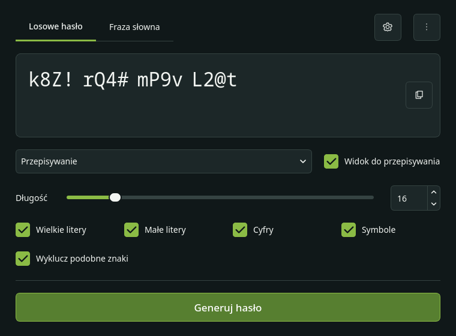 | 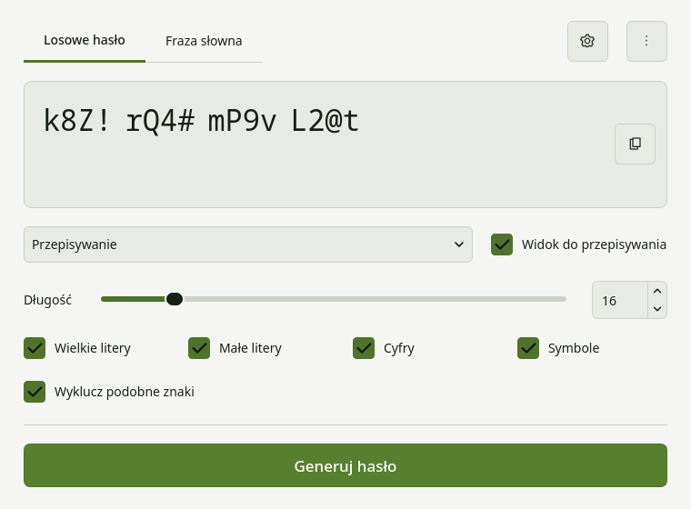 |
| Desktop: built-in Strong preset | 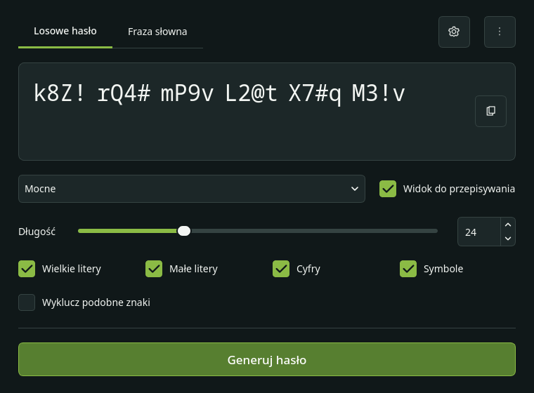 | 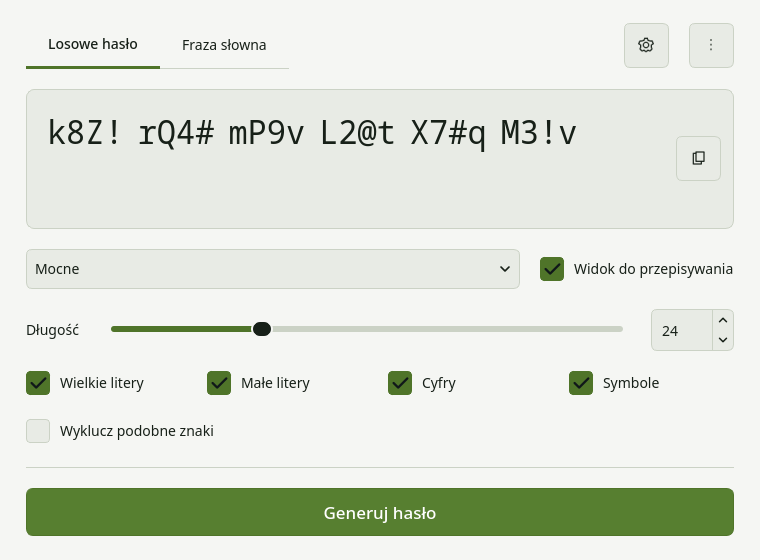 |
| Desktop: built-in Phrase preset | 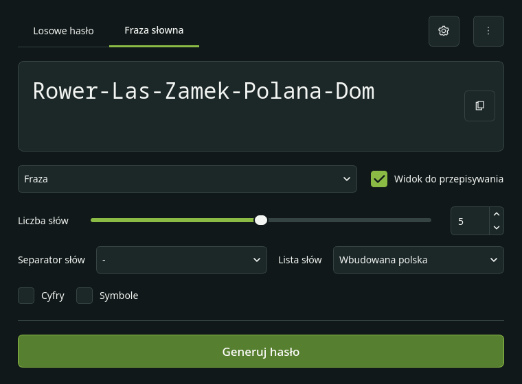 | 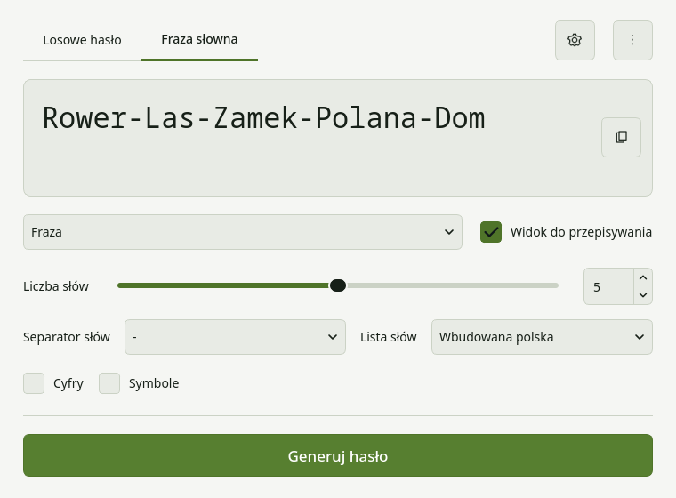 |
| Android: transcription | 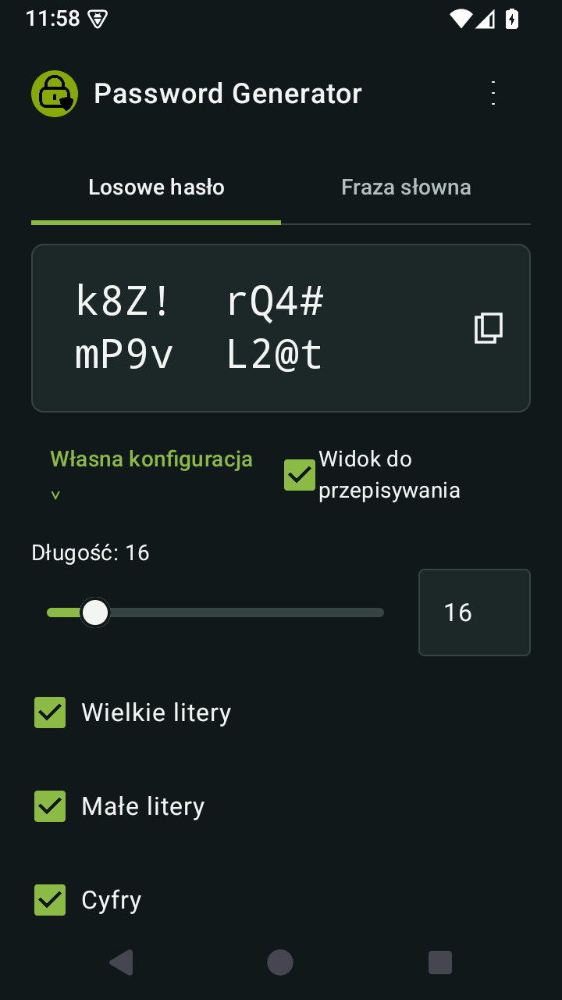 | 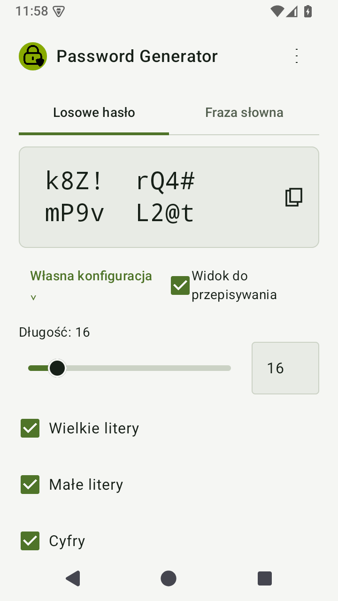 |
| Android: exclusion and generation options | 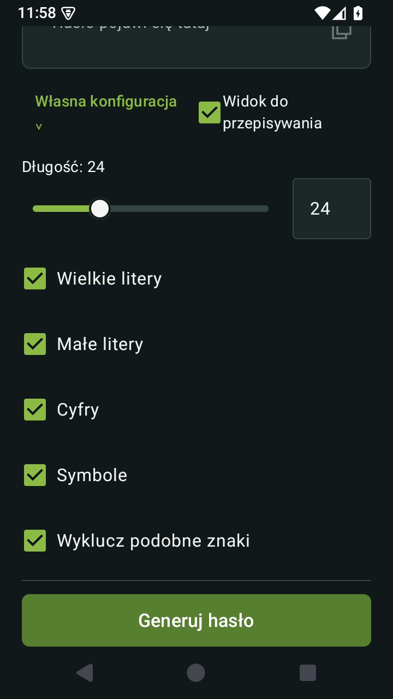 | 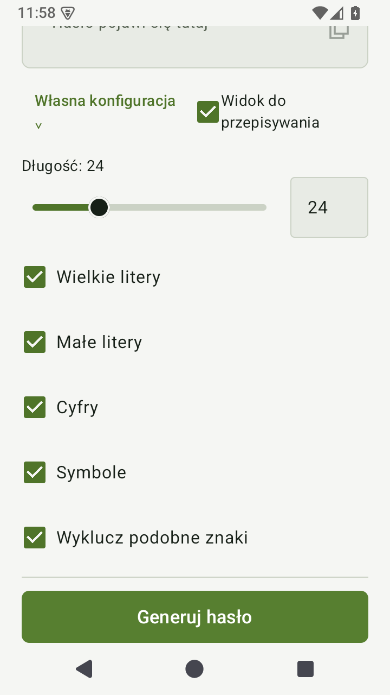 |
| Android: preset menu | 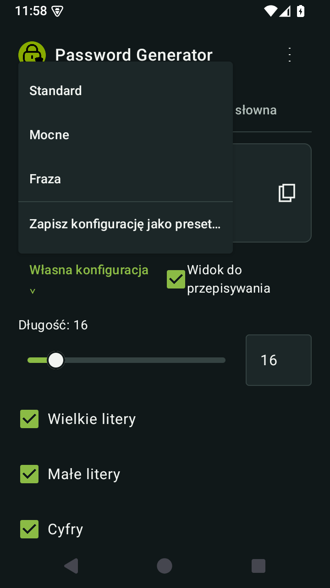 | 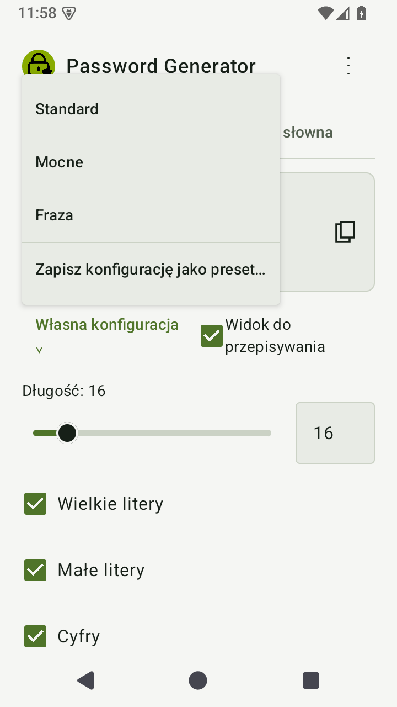 |
| Android: built-in Phrase preset | 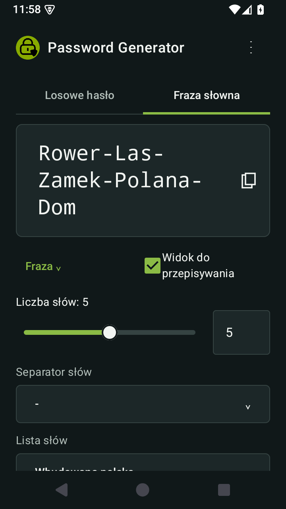 | 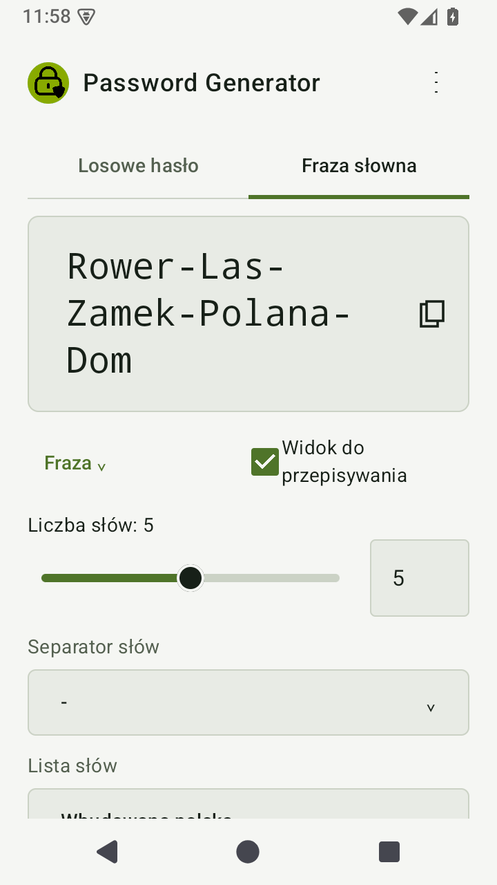 |

Desktop settings: [dark](desktop-dark-settings.png),
[light](desktop-light-settings.png), [English/narrow window](desktop-english-narrow.png).
Android settings: [dark](android-dark-settings.png),
[light](android-light-settings.png), [English](android-english.png),
[larger font](android-english-large-font.png).

The phone screen scrolls vertically to reach options below the current viewport;
the result also scrolls for long passwords. Screenshots preserve that real layout.
Transcription spacing is visual; the underlying value and clipboard remain raw.

## Reproduce

Desktop, using isolated temporary settings:

```bash
QT_QPA_PLATFORM=offscreen QT_QPA_PLATFORMTHEME= python scripts/preview_desktop.py --output docs/v1.2.0-preview
```

Android, with a running emulator and the usual JDK/SDK environment:

```bash
ANDROID_SERIAL=emulator-5554 bash scripts/android_ui_checks.sh
```

Use the serial of your test emulator. The script runs connected tests, reinstalls
the same debug APKs, then runs the capture test and pulls images to
`build/android-ui-preview/v120-preview/`. Review those images before copying
them into this gallery. Device rotation and large font tests are included.

The images are screenshots, not generated mockups. Only public example values
are seeded in memory by the preview scripts/tests. Test configuration and preset
storage are checked separately to ensure they contain no result or fragments.

## Capture provenance

The Android images above were refreshed from the physical Samsung SM-A145R
(Android 15 / API 35), captured in landscape by the rotation/capture tests.
They include the corrected vector dropdown arrows. They depict commit
`6142788e7453e365925bd9140c477efd02103ebb`, before the subsequent generator-only
word-case consistency correction. The public demonstration strings are unchanged
by that correction. Desktop captures use the isolated preview script.

[Physical-phone test output: 10 passed](phone-api35-tests.txt).
[Test handoff and remaining acceptance checks](../v1.2.0-validation.md).
