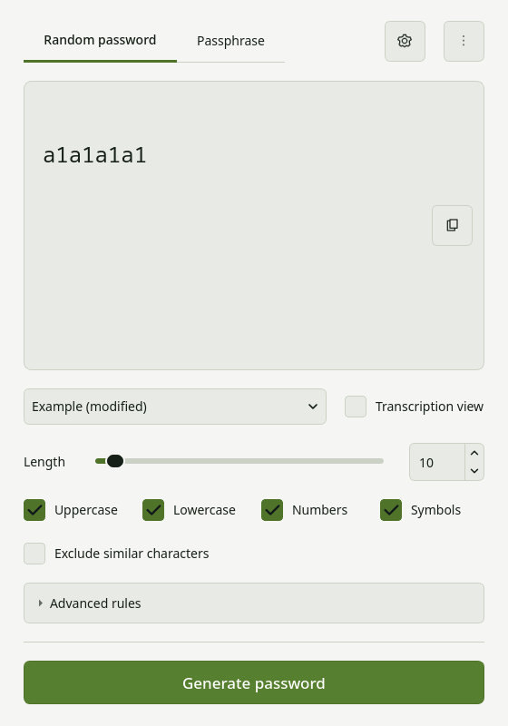
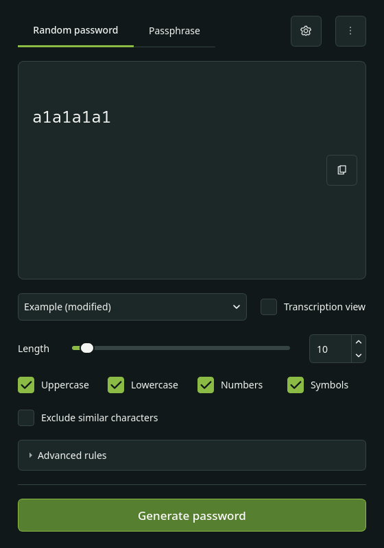
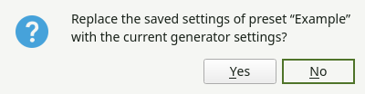
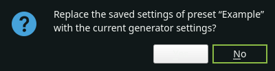
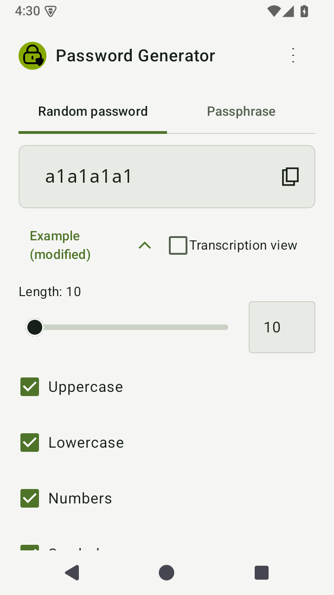
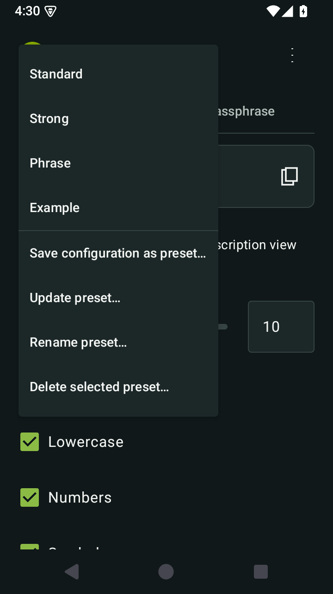
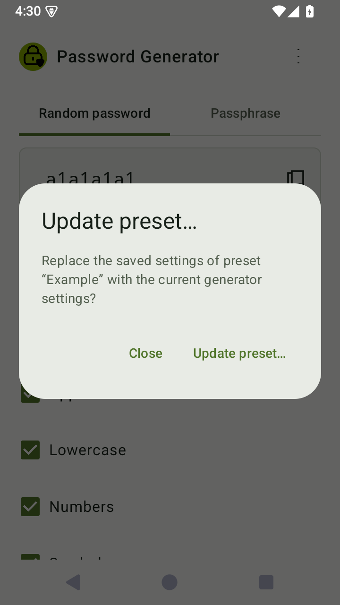
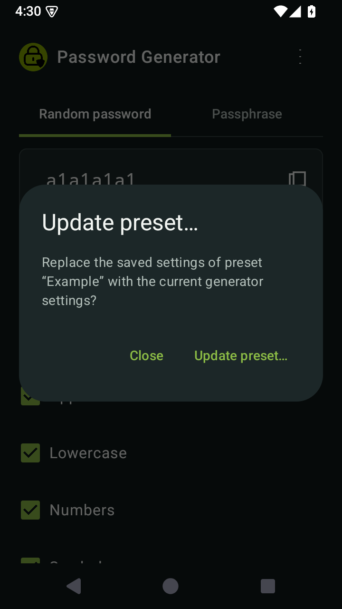

# v1.4.0 — preset editing

Select a custom preset, adjust the generator controls, and choose **Update
preset…** from the existing menu. Confirm the named replacement to save the
current configuration. **Save preset…** still creates a separate preset.

A changed custom preset stays selected and shows **modified**. Returning the
controls to the saved configuration removes that marker. Selecting another
preset replaces the draft as before. The editing target is not restored after
restarting the application.

**Rename preset…** changes only the saved name. It preserves any unsaved
configuration in the controls. Existing name validation and duplicate-name
checks apply, excluding the preset's own name. Built-in presets cannot be
updated, renamed or deleted.

Updating validates the configuration, checks advanced-rule feasibility in the
background, and verifies access to a custom word list. Missing desktop files or
Android URI permissions produce errors without dictionary substitution.
Validation failure, cancellation or a reported storage failure leaves the
in-memory saved preset unchanged. On write failure the application also attempts
to restore the previous preference value, since both storage APIs can update
their process cache before reporting an unsuccessful disk write. An ongoing
storage failure cannot provide a durability guarantee. Successful edits preserve
its ID and order.
No operation generates or automatically copies a password.

The existing version-2 storage format is unchanged. Legacy version-1 presets
retain lazy migration on the first successful mutation; unknown future formats
remain write-protected. Only active-mode generator parameters are serialized,
never generated results or the transient editing target.

Import/export, synchronization and changes to the generation algorithm are
outside this update. Version metadata remains derived from release tags.

## Previews

The previews show the running application with isolated settings and the
intentionally public, forced example `a1a1a1a1`. Existing release screenshots
remain unchanged. Desktop captures can be reproduced with:

```bash
QT_QPA_PLATFORM=offscreen QT_QPA_PLATFORMTHEME= python scripts/preview_preset_editing.py
```

Android captures are produced by
`AdvancedUiTest.capturePresetEditingInBothThemes` on an API-35 emulator.

| View | Light | Dark |
| --- | --- | --- |
| Desktop draft |  |  |
| Desktop confirmation |  |  |
| Android menu |  |  |
| Android confirmation |  |  |

## Verification

See [validation results and change inventory](validation.md) and
[release acceptance](validation.md#release-acceptance).

[Release notes and downloads](../releases/v1.4.0.md).
