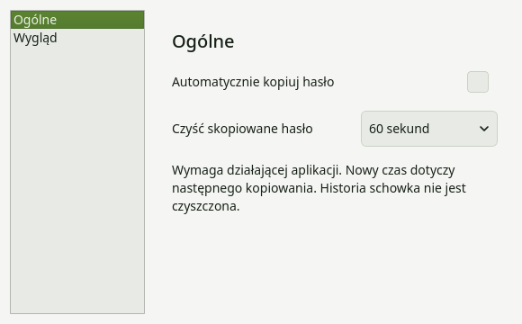
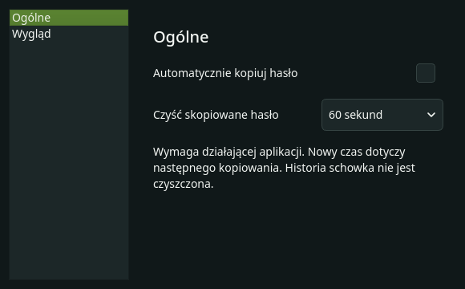
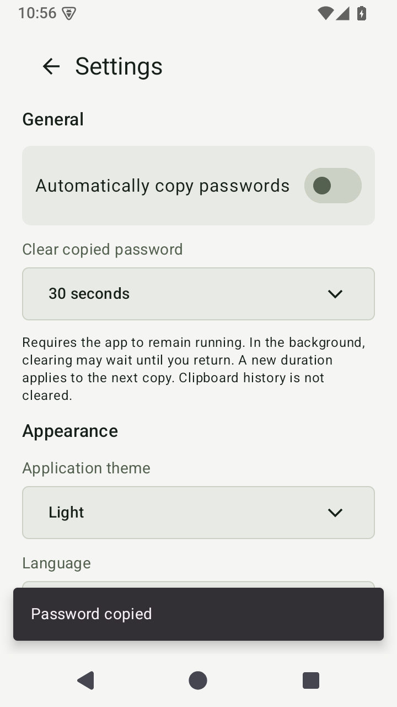
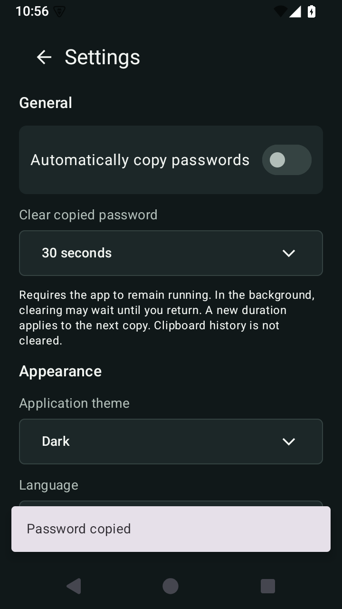

# v1.5.0 — clipboard expiry

Under **Settings → General → Clear copied password**, choose **Off**, **30**,
**60** or **120 seconds**. The default is **Off**, including after an upgrade.
Automatic copying remains off by default and is a separate setting.

Each successful copy starts a new deadline. Changing the duration applies to
the next copy; switching the feature off cancels pending cleanup immediately.
Turning it on does not adopt or clear anything already in the clipboard.
Generating another result, switching modes or applying a preset leaves an
existing copy's deadline unchanged. Cleanup leaves the displayed result intact.
The copy button, automatic copy, desktop keyboard/context-menu copy and Android
selection/accessibility copy all use the same controller on their platform.

## What can be cleared

The app attempts to remove only its latest marked clipboard entry. Before
clearing it checks a per-copy random marker and an exact UTF-8 content digest;
desktop additionally checks Qt clipboard ownership. Identical text copied by
another application without our marker is left alone. A missing marker, detected
replacement or uncertain ownership prevents cleanup. The marker is an identity
hint, not an authentication boundary against another application deliberately
replaying clipboard metadata.

No generated result, digest, marker or deadline is persisted. Only the selected
duration is saved; it is not part of presets. A single pending entry's metadata
lives in RAM, with no password history or extra plaintext snapshot. Restarting
or terminating the process loses the pending operation. Closing the app before
the deadline does not force an early cleanup and cannot guarantee later cleanup.

On **Android**, access is gated by window focus. The deadline continues in the
background, but an expired entry may only be checked after returning to the
app. Rotation retains the pending state in the ViewModel. API 28+ clears the
primary clip; API 26–27 replaces a confirmed own entry with empty text. Existing
Android 13+ sensitive-data metadata is preserved. No service, alarm, extra
permission or background worker is added.

On **desktop**, cleanup affects only the regular clipboard, not X11 PRIMARY
selection. When Wayland access is unavailable without focus, checks are deferred
until activation. Suspend-aware elapsed clocks are used on Linux, Windows and
Android; late timers recheck the deadline instead of assuming they fired on time.

System APIs do not supply an atomic compare-and-clear operation here. Validation
and the clear request run together on the UI thread, with internal generation
guards against stale callbacks, but cross-process races remain possible. This
feature is best effort: it does not purge clipboard history, keyboard/cloud
copies or data already read by another app, and OS restrictions or clipboard
errors can prevent cleanup. It is not a guarantee of secure erasure.

[Android ClipboardManager](https://developer.android.com/reference/android/content/ClipboardManager)
· [Qt QClipboard](https://doc.qt.io/qt-6/qclipboard.html).

## Implementation

The Python and Kotlin guards share the contract in
[`clipboard_contract.json`](../../tests/fixtures/clipboard_contract.json).
An injectable elapsed clock and clipboard adapter make deadline, failure and
reentrancy tests deterministic without waiting 30–120 seconds. Framework
controllers handle scheduling and focus/change notifications. While armed,
pending timers use intervals of up to one second so suspend does not leave a
full pre-suspend timer interval to run after waking. Timer checks do not read the
clipboard before expiry. If access is
unavailable or clearing fails, there is no polling loop: a subsequent focus or
clipboard-change event can retry. Disabling or disposing drops the pending state.

The saved preference `clipboard_clear_seconds` accepts only `0`, `30`, `60`,
`120`; unsupported values fall back to off. Generator configuration, preset
schema, randomness, signing, licensing and release mechanisms are unchanged.
Application version metadata still comes from tags; this working version is
not manually labeled 1.5.0 in application metadata.

## Verified settings previews

Desktop captures use isolated settings and do not change the system clipboard.
Android captures use public example strings on an API-35 emulator. Existing
v1.4.0 screenshots remain unchanged.

| Platform | Light | Dark |
| --- | --- | --- |
| Desktop |  |  |
| Android |  |  |

Reproduce the desktop previews with:

```bash
QT_QPA_PLATFORM=offscreen QT_QPA_PLATFORMTHEME= python scripts/preview_clipboard_settings.py
```

Android captures are produced by
`ClipboardUiTest.settingsCopyRoutesPersistenceAndPublicPreviews`.

[Validation and remaining manual checks](validation.md).

[Release notes and downloads](../releases/v1.5.0.md).
